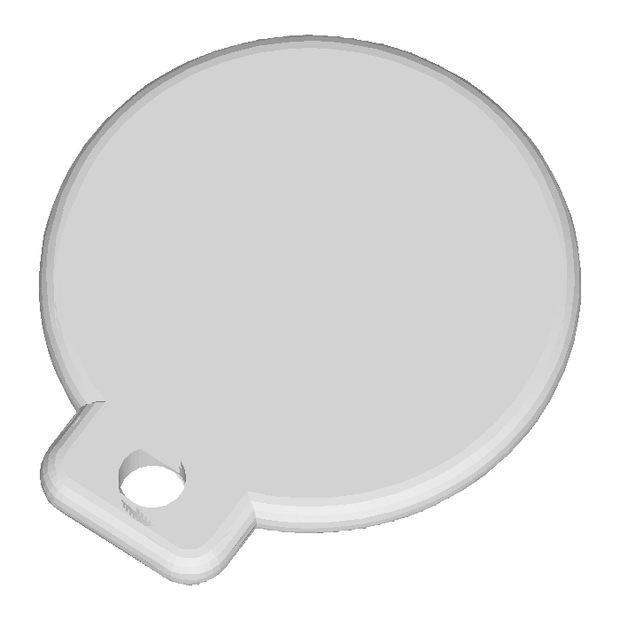

# Брелок с QR-кодом

Генератор брелоков для ключей с QR-кодом: вводишь текст — программа сама строит
QR, подбирает диаметр брелока, делает тело с ушком и отверстием и отдаёт **3MF**,
где тело, код и прицел — **три отдельные части** (в Bambu / Orca каждую красишь отдельно).



## Что умеет

- **QR генерируется локально** — интернет не нужен (`segno` лежит в `lib/`).
- **Диаметр подбирается под код**: `√2 × (код + 2 × обвязка)`, обвязка — зазор, прицел и поле.
- **Модуль QR 0,80 мм** — оптимум для сканера телефона.
- **Тело параметрическое**: круг, ушко, отверстие Ø4,5, скругления углов R3 и кромок R1,5/R1,0.
- **3MF с тремя частями**: `Brelok`, `QR`, `Sight`. В слайсере каждая часть красится отдельно.
- Таблица размеров прямо в окне: от версии 1 (Ø32) до версии 10 (Ø72).

## Запуск

Нужен Windows и Python 3.12 (всё остальное уже в комплекте — `lib/` с зависимостями).

```
run.bat
```

Или вручную:

```
python app.py
```

## Как это выглядит

1. Вводишь текст, например `ЕСЛИ НАШЛИ 81234567899`.
2. Программа показывает версию QR, размер модуля, диаметр брелока и сколько байт занято.
3. Жмёшь **Сохранить 3MF**.
4. В Bambu Studio: импорт → «как один объект с несколькими частями» → часть `QR` и часть `Sight` красишь в свой цвет.

## Что внутри

| Файл | Назначение |
|---|---|
| `app.py` | окно: ввод текста, превью, расчёт, сохранение |
| `qrgen.py` | QR, ёмкость, расчёт диаметра |
| `body.py` | параметрическое тело (триангуляция с дыркой, аналитические скругления) |
| `mesh.py` | кубики QR и прицела, сборка 3MF, запись STL |
| `lib/` | segno (QR) и mapbox-earcut (триангуляция) |
| `render_stl.py` | рендер STL в PNG — проверить форму глазами |
| `test_gen.py`, `test_body.py` | проверки без окна |

## Технические подробности

- QR утоплен в тело на 0,1 мм, чтобы при печати гарантированно слился.
- Высота рельефа 0,6 мм: тело 3,0 мм, QR до 3,6 мм.
- Ширина ушка — 0,40 × диаметр, но не меньше 10 мм.
- Отверстие под кольцо — 4,5 мм, не зависит от диаметра.
- Скругления строятся аналитически (сдвиг радиусов), поэтому на стыке ушка и круга нет залома.

## Видео

Как сделано — по шагам, без монтажа:

- Часть 1, вручную в Fusion 360 с DeepSeek Harness: https://youtu.be/G4yrQJpS6Z0
- Часть 2, генератор: https://youtu.be/WnceKJaBmqs

## Лицензия

MIT — делай что хочешь, только не убирай упоминание автора.
